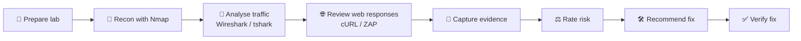

<div align="center">

# 🛡️ SWYNEX — Final Security Assessment

**A consolidated, evidence-based security report built from three hands-on lab exercises**


**Author:** Rakesh Babriya &nbsp;|&nbsp; **Period:** October 2026

[📄 Read the Final Report](report/final-security-assessment.md) · [🖼️ View Evidence](evidence/) · [🔗 LinkedIn](https://linkedin.com/in/rakeshbabriya)

</div>

---

## 📌 Overview

This repository is the **final deliverable (Task 4)** of the SWYNEX security program. It brings together the results of three earlier exercises into one clear report.

| # | Exercise | Focus |
|---|----------|-------|
| 1 | **Security Fundamentals Assessment** | Core security concepts and basic assessment workflow |
| 2 | **Network Security Analysis** | DNS, HTTP, TLS and TCP traffic analysis |
| 3 | **Web Security Review** | Security headers, cookies and exposed directories |

> **Goal:** show how a security finding goes from *observation → evidence → risk → fix → verification*.

---

## 🎯 What Makes This Report Different

- ✅ **Evidence first.** Every finding points to a screenshot in `evidence/`.
- ✅ **Confirmed vs. potential.** Facts are separated from possible risks.
- ✅ **Fix included.** Each finding has a remediation and a way to check it worked.
- ✅ **Clean data.** Credentials, tokens and private identifiers are removed.

---

## 📂 Repository Structure

```text
SWYNEX-Security-Assessment/
│
├── 📁 evidence/                         ← Supporting screenshots (01 – 11)
│   ├── 01–03  Juice Shop (headers)
│   ├── 04–07  Network analysis
│   └── 08–11  DVWA findings
│
├── 📁 report/
│   ├── final-security-assessment.md     ← ⭐ Main consolidated report
│   ├── task-1-source-report.md          ← Original Task 1 (reference)
│   ├── task-2-source-report.md          ← Original Task 2 (reference)
│   └── task-3-source-report.md          ← Original Task 3 (reference)
│
└── README.md                            ← You are here
```

> 💡 **Start here:** open `report/final-security-assessment.md`. The three source reports are kept only as reference.

---

## 🔍 Findings at a Glance

| ID | Finding | Target | Evidence |
|----|---------|--------|----------|
| F-01 | Anti-clickjacking protection | Juice Shop | `01-juice-shop-anti-clickjacking.png` |
| F-02 | Content Security Policy (CSP) | Juice Shop | `02-juice-shop-csp.png` |
| F-03 | Content-type sniffing protection | Juice Shop | `03-juice-shop-content-type-options.png` |
| F-04 | Directory listing enabled | DVWA | `08-dvwa-directory-listing.png` |
| F-05 | Missing security headers | DVWA | `09-dvwa-security-headers.png` |
| F-06 | Session cookie attributes | DVWA | `10-dvwa-cookie-attributes.png` |
| F-07 | Exposed `includes/` directory | DVWA | `11-dvwa-includes-directory.png` |

Network analysis (DNS, HTTP, TLS, TCP) is documented as **observations**, not vulnerabilities. See [Section 5 of the report](report/final-security-assessment.md).

> 📝 Severity ratings, status and full details are in the final report.

---

## 🧭 Assessment Workflow



---

## 🧰 Tools Used

| Category | Tools |
|----------|-------|
| **Operating system** | Kali Linux on VMware Workstation |
| **Lab targets** | OWASP Juice Shop, DVWA (run in Docker) |
| **Recon** | Nmap |
| **Traffic analysis** | Wireshark, tshark |
| **Web testing** | cURL, OWASP ZAP |

---

## 🔐 Scope and Authorization

- 🟢 **In scope:** local training apps only (`127.0.0.1:3000` Juice Shop, `127.0.0.1:8080` DVWA) and local lab traffic.
- 🔴 **Out of scope:** any external, public or production system.
- 🧹 **Data handling:** sensitive values were removed or blurred before publishing.

---

## 📖 How to Read This Repository

1. Read the **Executive Summary** in the final report.
2. Check the **Findings Register** for severity and status.
3. Open the linked **evidence screenshot** for any finding.
4. Use the **Remediation** and **Verification** steps to see how it would be fixed.

---

## 👤 Author

**Rakesh Babriya** — Computer Science Engineering student, aspiring SOC / Cybersecurity Analyst.

[](https://linkedin.com/in/rakeshbabriya)
[](https://github.com/realeesh17)

---

## ⚠️ Disclaimer

This repository documents **authorized, educational** security testing in a private lab. It is **not** a certification of any production system. Do not use these techniques against systems you do not own or have written permission to test.

<div align="center">

⭐ If you found this useful, consider starring the repository.

</div>
